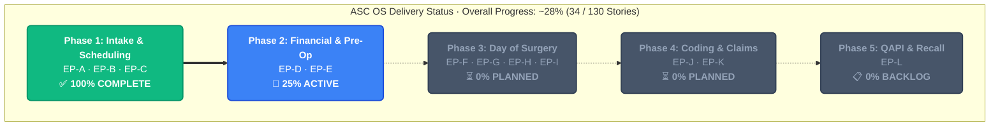
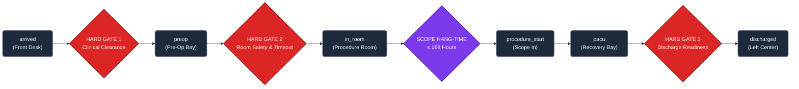
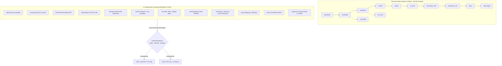
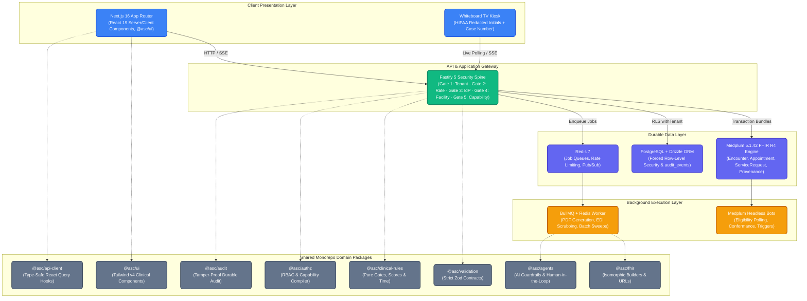

# ASC EHR — Gastrointestinal Ambulatory Surgery Center Operating System

[](https://turbo.build/repo)
[](https://nextjs.org/)
[](https://fastify.dev/)
[](https://medplum.com/)
[](https://orm.drizzle.team/)
[](https://bullmq.io/)
[-3178c6.svg>)](https://www.typescriptlang.org/)
[-success.svg>)](PROGRESS.md)

ASC EHR is a clinical-grade, high-throughput **Ambulatory Surgery Center (ASC) Operating System and Electronic Health Record (EHR)** purpose-built specifically for **single-specialty Gastrointestinal (GI) endoscopy facilities**.

Designed to govern the entire perioperative continuum from inbound fax referral to automated claims submission and surveillance recall, ASC EHR operates with **zero paper backup**. It reconciles high-velocity clinical turnover with strict regulatory enforcement, autonomous financial clearance, and native GI multiple endoscopy coding rules.

---

## Delivery Status & Implementation Roadmap



```text
Total Delivery Progress: [██████░░░░░░░░░░░░░░] 28% Complete

Phase 1  [██████████] 100%  COMPLETE  │ Foundation, Intake & Scheduling (PR #79 merged)
Phase 2  [███░░░░░░░]  25%  ACTIVE    │ Financial Clearance & Pre-Op Readiness (P15c, P17, P16, P22a)
Phase 3  [░░░░░░░░░░]   0%  PLANNED   │ Day of Surgery, Documentation, Pathology & Scopes
Phase 4  [░░░░░░░░░░]   0%  PLANNED   │ Coding Engine, Multiple Endoscopy & Claims Cycle
Phase 5  [░░░░░░░░░░]   0%  BACKLOG   │ Quality, QAPI & Surveillance Recall Ladder
```

> 📖 **Detailed Sprint Tracking:** See [PROGRESS.md](PROGRESS.md) for granular task breakdowns, daily commits, and blocking lead-time items. See [docs/plan/implementation-plan.md](docs/plan/implementation-plan.md) for the master phase architecture.

---

## Core Clinical Safety: The 3 Strict Hard Gates

Patient safety in ASC EHR is governed by three non-negotiable **Clinical Hard Gates** and a **Sterile Scope Hang-Time Lock**. Physical case state progression is blocked until mandatory safety criteria are met:



- **Gate 1 (`arrived` ➔ `preop`)**: Evaluated by [`evaluateGate1`](packages/clinical-rules/src/gates/gate1.ts). Requires positive 2-factor identity, signed tablet consent, valid H&P (< 30 days + update note), NPO, and adult escort. **Identity and consent are strictly non-waivable by any role.**
- **Gate 2 (`preop` ➔ `in_room`)**: Evaluated by [`evaluateGate2`](packages/clinical-rules/src/gates/gate2.ts). Requires pre-anesthesia clearance (ASA class + Mallampati score), anticoagulation hold verification, equipment readiness, and synchronous multi-role timeout attestation (MD, CRNA, RN).
- **Gate 3 (`pacu` ➔ `discharged`)**: Requires Aldrete recovery score $\ge 9$, stable interval vitals, bedside physical escort verification, signed procedure note, and printed discharge instructions.
- **Scope Hang-Time Lock**: Evaluated by [`evaluateScopeHangTime`](packages/clinical-rules/src/gates/scope-hang-time.ts). Enforces **168 hours (7 days) maximum** elapsed from sterile reprocessing. Zero overrides permitted.

---

## Architectural Core: Stage vs. Readiness Decoupling

ASC EHR decouples physical patient **Stage** (where the patient physically is, 12 sequential states) from computed **Readiness** (pure functional reduction over 12 clinical & administrative checks):



- **Zero Combinatorial Explosion**: Eliminates 140+ synthetic statuses; physical stage moves forward while readiness evaluates dynamically.
- **Non-Blocking Financial Flow**: Pending insurance authorizations route asynchronous `Task` items to billing staff without blocking arrived patients from clinical pre-op preparation.

> 📖 **Full Specification:** See [docs/product/09-clinical-safety-and-stage-readiness.md](docs/product/09-clinical-safety-and-stage-readiness.md) for the complete hard gates rules, waiver hierarchy, and FHIR R4 extension mappings.

---

## Master Architecture & Technology Stack



### Technology Matrix

| Layer             | Component           | Stack & Version                                                                                                                                                                                     | Architectural Responsibility                                                               |
| ----------------- | ------------------- | --------------------------------------------------------------------------------------------------------------------------------------------------------------------------------------------------- | ------------------------------------------------------------------------------------------ |
| **Monorepo**      | Build & Workspaces  | [](https://turbo.build/repo) [](https://pnpm.io/)                    | Strict workspace boundaries, package caching, zero circular dependencies                   |
| **Frontend**      | Clinical Web App    | [](https://nextjs.org/) [](https://react.dev/)                           | Next.js App Router, Server/Client Components, accessible clinical forms, Whiteboard Kiosk  |
| **UI Kit**        | Clinical Components | [](https://tailwindcss.com/) [](https://ui.shadcn.com/) | Arm's-length touch targets ($\ge 44\text{ px}$), high-contrast clinical themes             |
| **API Server**    | Security Spine API  | [](https://fastify.dev/)                                                                                                             | High-performance schema validation, default-deny 5-gate security spine                     |
| **Clinical Core** | FHIR Datastore      | [](https://medplum.com/)                                                                                                          | Self-hosted FHIR R4 engine, OAuth2/OIDC IdP, immutable audit & FHIR subscriptions          |
| **App Database**  | Multitenant DB      | [](https://www.postgresql.org/) [](https://orm.drizzle.team/)   | Multi-tenant isolation via PostgreSQL Row-Level Security (`withTenant`), append-only audit |
| **Job Queues**    | Background Workers  | [](https://bullmq.io/) [](https://redis.io/)                               | Asynchronous background pipelines (claims, PDF consent, notification sweeps)               |
| **Type Safety**   | Language Standard   | [](https://www.typescriptlang.org/)                                                                                   | Zero `any` or `unknown` types across all packages; strict compile-time checks              |

---

## Monorepo Layout

```text
ASC_EHR/
├── apps/
│   ├── api/                    # Fastify 5 REST API, security spine & case controllers
│   ├── web/                    # Next.js 16 clinical application, patient chart & whiteboard
│   ├── worker/                 # BullMQ background workers for async processing
│   └── bots/                   # Medplum Bots for FHIR automation and subscription handling
├── packages/
│   ├── clinical-rules/         # Pure clinical logic: Hard Gates 1/2/3, Scope Hang-Time, BBPS, Aldrete
│   ├── fhir/                   # Isomorphic FHIR R4 resource builders, CodeSystems & ValueSets
│   ├── validation/             # Canonical Zod schemas powering forms and API payload validation
│   ├── authz/                  # Capability catalog, role templates, access policy compiler
│   ├── ui/                     # Accessible Tailwind v4 clinical components (Whiteboard, Stepper, Banner)
│   ├── api-client/             # Type-safe API client and TanStack React Query hooks
│   ├── agents/                 # AI Agent Layer with strictly enforced commit boundaries
│   ├── db/                     # Drizzle ORM schema, migrations, RLS tenant isolation
│   ├── audit/                  # HIPAA durable append-only audit event logging
│   ├── logger/                 # Structured JSON logger with automatic PHI redaction
│   ├── telemetry/              # OpenTelemetry instrumentation and tracing
│   ├── types/                  # Shared TypeScript interfaces (strictly no schemas or runtime code)
│   └── config/                 # Centralized, Zod-validated environment configuration
├── docs/
│   ├── plan/                   # Master implementation plan, Gantt roadmaps & phase specs
│   ├── decisions/              # Architecture Decision Records (ADRs)
│   └── product/                # Clinical requirements and domain architecture specifications
├── infra/
│   ├── medplum/                # Local and cloud Medplum configuration, seed profiles & policies
│   └── terraform/              # Azure infrastructure as code (AKS, Postgres, Redis, KeyVault)
├── PROGRESS.md                 # Live single source of truth for engineering velocity & status
└── LEARNING_MISTAKES.md        # Monorepo mistakes log and permanent architectural guardrails
```

---

## Quickstart & Local Development

### Prerequisites

- **Node.js**: $\ge 20.18.0$
- **pnpm**: $\ge 10.26.2$ (`corepack enable`)
- **Docker**: Docker Engine $\ge 24$ and Docker Compose $\ge 2.20$

### 1. Environment Setup & Dependency Installation

```bash
# Clone the repository
git clone https://github.com/imRahul05/ASC-EHR.git
cd ASC_EHR

# Install all workspace dependencies
pnpm install
```

### 2. Start Supporting Infrastructure

Start local PostgreSQL and self-hosted Medplum FHIR server with seeded clinical practitioners:

```bash
# Start PostgreSQL (Database port 5432)
pnpm db:up

# Run Drizzle migrations
pnpm db:migrate

# Start Medplum FHIR R4 server + Admin App (Ports 8203 / 3003)
pnpm medplum:up

# Seed demo facility, roles, practitioners, and clinical catalogs
pnpm medplum:seed
```

### 3. Launch Development Environment

```bash
# Starts Next.js (Web: 3000), Fastify (API: 8000), and BullMQ Worker in parallel
pnpm dev
```

Navigate to:

- **Clinical App**: [http://localhost:3000](http://localhost:3000)
- **Whiteboard TV Kiosk**: [http://localhost:3000/board](http://localhost:3000/board)
- **Fastify API Health**: [http://localhost:8000/health](http://localhost:8000/health)
- **Medplum Admin Console**: [http://localhost:3003](http://localhost:3003)

---

## Verification & Quality Gates

Every pull request must satisfy all 50+ Turborepo quality checks without exception:

```bash
# Run strict TypeScript typechecking across all packages (Zero any / unknown)
pnpm typecheck

# Run type-aware ESLint checks (App boundaries, PHI redaction, hook budgets)
pnpm lint

# Execute Vitest test suites across all packages and apps
pnpm test

# Verify production build compilation for all targets
pnpm build
```

---

## Key Documentation & Architecture References

- **[PROGRESS.md](PROGRESS.md)**: Live sprint board, completed phase logs, and active blockers.
- **[LEARNING_MISTAKES.md](LEARNING_MISTAKES.md)**: Catalog of historical defects and preventative architectural rules (LM-001 through LM-030).
- **[docs/plan/implementation-plan.md](docs/plan/implementation-plan.md)**: Master phase plan and global dependency matrix.
- **[docs/decisions/](docs/decisions/)**: Architecture Decision Records (ADRs) on identity, concurrency, and distributed locking.
- **[AGENTS.md](AGENTS.md)**: Strict autonomous agent contribution rules, session hygiene, and git branch protocols.
