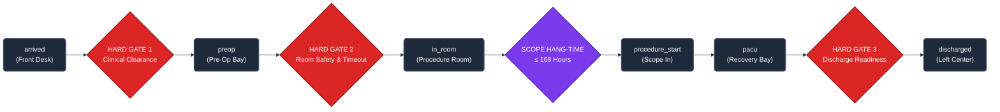
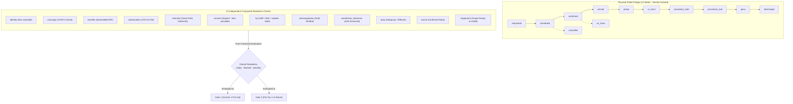
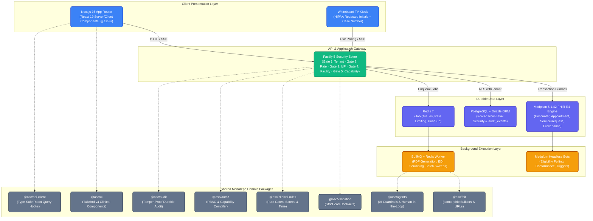

# ASC EHR — Gastrointestinal Ambulatory Surgery Center Operating System

[](https://turbo.build/repo)
[](https://nextjs.org/)
[](https://fastify.dev/)
[](https://medplum.com/)
[](https://orm.drizzle.team/)
[](https://bullmq.io/)
[-3178c6.svg>)](https://www.typescriptlang.org/)
[-success.svg>)](PROGRESS.md)

ASC EHR is a clinical-grade, high-throughput **Ambulatory Surgery Center (ASC) Operating System and Electronic Health Record (EHR)** purpose-built specifically for **single-specialty Gastrointestinal (GI) endoscopy facilities**.

Designed to govern the entire perioperative continuum from inbound fax referral to automated claims submission and surveillance recall, ASC EHR operates with **zero paper backup**. It reconciles high-velocity clinical turnover with strict regulatory enforcement, autonomous financial clearance, and native GI multiple endoscopy coding rules.

---

## Delivery Status & Implementation Roadmap

Every story and acceptance criterion in this repository traces directly to **Anurag Chatterjee's Master Build Specification** (`build_specification.md`) and **Requirements Document** (`requirements_document.md`).

| Phase             | Master Epics               | Scope & Milestone Deliverables                                                                                                                                                                                                                                                                                                                                                                                                                                                                                                                                                                             | Target Horizon            | Status                                 |
| ----------------- | -------------------------- | ---------------------------------------------------------------------------------------------------------------------------------------------------------------------------------------------------------------------------------------------------------------------------------------------------------------------------------------------------------------------------------------------------------------------------------------------------------------------------------------------------------------------------------------------------------------------------------------------------------- | ------------------------- | -------------------------------------- |
| **Phase 1**       | **EP-A, EP-B, EP-C**       | **Foundation, Referral Intake & Registration, Scheduling & Whiteboard**<br>• Core configuration, RBAC, capabilities, durable HIPAA audit (`audit_events`)<br>• Isomorphic FHIR R4 builders (`@asc/fhir`) & Medplum 5.1.42 integration<br>• Patient registration, duplicate match engine, coverage intake (`P14a/b`)<br>• Case scheduling, conflict engine, booking API, double-checked idempotency (`P15a`)<br>• Whiteboard TV Kiosk with strict initials-only PHI redaction (`P15b` / PR #79)                                                                                                             | 6 weeks before opening    | **100% COMPLETE**<br>_(PR #79 merged)_ |
| **Phase 2**       | **EP-D, EP-E**             | **Financial Clearance, Pre-Op Readiness & Hard Gate 1**<br>• **P15c**: Live Case Read, Schedule & Stage Transition Backend APIs (`GET /schedule`, `GET /cases/:id`, `POST /cases/:id/transition`)<br>• **P17**: Pre-op nursing, digital tablet consent (`SignaturePad` + signed PDF rendering), and Gate 1 enforcement (`arrived` ➔ `preop`)<br>• **P16**: Pre-procedure H&P review, 30-day update note, and anticoagulation drug-hold rules engine<br>• **P22a**: Financial clearance pipeline, 270/271 eligibility monitor, 278 auth revalidation, Good-Faith Estimates & patient payment                | 4 weeks before opening    | **CURRENT FOCUS / ACTIVE**             |
| **Phase 3**       | **EP-F, EP-G, EP-H, EP-I** | **Day of Surgery, Clinical Documentation, Specimens & Scope Reprocessing**<br>• **EP-F**: Gate 2 multi-role timeout, continuous AIMS vital signs, intra-op room event log, PACU recovery (Aldrete score), Gate 3 discharge<br>• **EP-G**: Discrete findings (Paris classification), BBPS scoring, live cecal withdrawal timer, procedure note signing & immutability<br>• **EP-H**: Closed-loop pathology, container barcoding, 2-year open-specimen register, 1-hour critical result routing<br>• **EP-I**: Scope reprocessing log, serial barcode tracking, **168-hour hang-time lock (zero overrides)** | 2 weeks before opening    | **PLANNED**                            |
| **Phase 4**       | **EP-J, EP-K**             | **Coding & Multiple Endoscopy Engine, Claims & Clearinghouse Cycle**<br>• **EP-J**: Derivation of CPT/ICD codes from structured findings, modifier PT/33 (screening ➔ therapeutic conversion), multiple endoscopy reduction rules, Gate 3 physician code approval<br>• **EP-K**: Native 837 claim export, 277CA acceptance tracking, 835 remittance posting, denial worklists & appeal management                                                                                                                                                                                                          | Opening week              | **PLANNED**                            |
| **Phase 5**       | **EP-L**                   | **Quality, QAPI & Surveillance Recall Ladder**<br>• Adenoma Detection Rate (ADR) calculation, prep adequacy reporting, perforation & hospital transfer tracking<br>• CMS ASCQR export without manual abstraction<br>• Multi-year surveillance recall register with automated patient outreach ladder                                                                                                                                                                                                                                                                                                       | Within 30 days of opening | **BACKLOG**                            |
| **Cross-Cutting** | **EP-M**                   | **AI Agent Layer with Strict Human-in-the-Loop Commit Boundary**<br>• Ships alongside automated epics (intake, clearance, scribe, coding suggestions)<br>• **Strict Boundary**: Agents propose; agents NEVER sign notes, approve codes, waive checks, or pass hard gates                                                                                                                                                                                                                                                                                                                                   | All phases                | **ACTIVE**                             |

> [!IMPORTANT]
> **Single Source of Truth:** Track granular sprint progression, daily commits, and blocking external lead-time escalations in [PROGRESS.md](PROGRESS.md). Consult [docs/plan/implementation-plan.md](docs/plan/implementation-plan.md) for the master architectural roadmap.

---

## Product Vision & Clinical Context

Generic hospital EHRs fail ambulatory surgery centers. In a busy single-specialty GI endoscopy center:

- **Turnover velocity is extreme:** Dr. R (Endoscopist) performs 12 to 14 procedures per block day, with as little as 90 seconds between cases. Screens requiring more than two taps or repeated confirmations cause abandonment.
- **Nursing interruptions are continuous:** Nina (Pre-Op Nurse) balances up to 8 patients simultaneously. Work-in-progress must never be lost when interrupted mid-entry.
- **In-room operation is hands-free or one-handed:** Carl (Circulator) stands gloved with one hand on the patient. Intra-procedure saves must complete within 500 ms (NFR-2) without keyboard dependency.
- **Front desk needs instantaneous financial answers:** Rosa (Front Desk) must instantly answer _"What do I owe today?"_ with computed deductible, coinsurance, and copay before the patient leaves reception.
- **Coding requires surgical specificity:** Mo (Coder) must audit AI-derived codes back to exact note passages, applying CMS multiple-endoscopy reduction rules, distinct anatomical site modifiers (59/X), and screening-to-therapeutic conversions (modifier PT for Medicare, modifier 33 for commercial).
- **Accreditation and Safety require non-negotiable guarantees:** Ana (Administrator) must prove record completeness, H&P currency (< 30 days), sterile scope hang-time (< 168 hours), and complete specimen custody to AAAHC, ACHC, or Joint Commission surveyors.

ASC EHR was architected from the ground up to solve these clinical realities without legacy baggage.

---

## Core Clinical Safety: The 3 Strict Hard Gates

Patient safety in ASC EHR is governed by three non-negotiable **Clinical Hard Gates** and a **Sterile Scope Hang-Time Lock**. These gates physically prevent case state progression until all required clinical criteria are satisfied.



### 1. Hard Gate 1: Arrived ➔ Pre-Op

- **Enforced by:** `evaluateGate1()` in [`@asc/clinical-rules`](packages/clinical-rules/src/gates/gate1.ts).
- **Mandatory Checks:**
  1. `identity`: Two-factor demographic verification (matched to record, Name + DOB confirmed).
  2. `consent`: Signed informed consent naming the specific planned procedure and performing physician.
  3. `hp`: History & Physical examination completed within 30 days of the procedure date, plus a signed pre-procedure update note confirming no interval clinical change.
  4. `npo`: Minimum fasting duration confirmed per anesthesia protocol.
  5. `escort`: Responsible adult escort confirmed to accompany the patient home.
- **Non-Waivable Rule:** Per REQ-5 §202 and AC-F-02-3, **`identity` and `consent` CANNOT be waived by any role, under any circumstances, including Administrator**. Attempts to waive fail closed. H&P may only be overridden by a credentialed clinician with a mandatory logged justification.

### 2. Hard Gate 2: Pre-Op ➔ In-Room

- **Enforced by:** `evaluateGate2()` in [`@asc/clinical-rules`](packages/clinical-rules/src/gates/gate2.ts).
- **Mandatory Checks:**
  1. `anesthesia_clearance`: Documented pre-anesthesia evaluation with ASA physical status classification and airway assessment (Mallampati score).
  2. `anticoagulation`: Anticoagulation/antiplatelet protocol clearance verified (documented hold window confirmed by prescriber, or explicitly marked not applicable).
  3. `equipment`: Required scope model and accessories confirmed available, reprocessed, and within hang-time.
  4. `timeout`: Synchronous multi-role attestation in the procedure room naming all participants (Physician, Anesthesia/CRNA, RN Circulator) verifying patient identity, procedure, site, allergies, and fire risk.

### 3. Hard Gate 3: PACU ➔ Discharge

- **Mandatory Checks:**
  1. `aldrete`: Modified Aldrete recovery score $\ge 9$ (or PADSS equivalent) with vital signs stable at protocol intervals.
  2. `escort_verified`: Physical presence of the confirmed responsible adult escort verified at the bedside before release.
  3. `signed_note`: Procedure note signed by the physician, or an immediate post-procedure note documenting findings, specimens, and complications.
  4. `discharge_instructions`: Printed and explained post-procedure instructions, dietary guidelines, emergency phone contacts, and anticoagulation restart schedule.

### Scope Reprocessing Hang-Time Hard Gate: 168 Hours (Zero Overrides)

- **Enforced by:** `evaluateScopeHangTime()` in [`@asc/clinical-rules`](packages/clinical-rules/src/gates/scope-hang-time.ts).
- **Maximum Limit:** **168 hours (7 calendar days)** elapsed from sterile reprocessing cycle completion.
- **Absolute Zero-Override Enforcement:** Per REQ-13 and AC-I-05-4, if an endoscope's hang-time exceeds 168 hours or its leak test failed, **no role (including Administrator) can override this lock**. The scope is immediately quarantined and cannot be booked or assigned to any procedure until re-sterilized.

---

## Architectural Core: Stage vs. Readiness Decoupling

The single most critical architectural insight in ASC EHR (REQ-5 §158–184) is the **complete decoupling of physical patient Stage from computed clinical/financial Readiness**.



### Why Decouple?

Traditional hospital EHRs collapse stage and readiness into monolithic enum statuses (e.g. `Checked-In-Auth-Pending`, `Checked-In-HP-Expired`), triggering a combinatorial explosion that makes automated reasoning impossible.

In ASC EHR:

1. **Stage represents where the patient physically is:** Stage transitions move forward only (`requested` ➔ `scheduled` ➔ `confirmed` ➔ `arrived` ➔ `preop` ➔ `in_room` ➔ `procedure_start` ➔ `procedure_end` ➔ `pacu` ➔ `discharged`). Reversals (e.g. patient sent from room back to pre-op) are explicit, audited transactions.
2. **Readiness is dynamically computed, never stored:** Readiness is a pure functional reduction over 12 independent checks. Each check evaluates to `satisfied`, `pending`, `failed`, or `waived`.
3. **Financial readiness never blocks clinical care:** An uncleared authorization or pending deductible does NOT trap an arrived patient in the waiting room. It automatically routes a prioritized `Task` to Dee (Financial Clearance) while clinical care proceeds through Gate 1. Only clinical hard gates block physical stage progression.

---

## Master Architecture & Technology Stack



### Technology Matrix

| Layer             | Technology                        | Version                     | Architectural Responsibility                                                               |
| ----------------- | --------------------------------- | --------------------------- | ------------------------------------------------------------------------------------------ |
| **Monorepo**      | Turborepo + pnpm                  | Turborepo 2.11 · pnpm 10.26 | Strict workspace boundaries, package caching, zero circular dependencies                   |
| **Frontend**      | Next.js App Router                | Next.js 16.0 · React 19.0   | Server & Client Components, accessible clinical forms, Whiteboard TV Kiosk                 |
| **UI Kit**        | Tailwind CSS v4 + Radix / Base UI | Tailwind 4.0 · Base UI      | Arm's-length touch targets ($\ge 44\text{ px}$), high-contrast clinical themes             |
| **API Server**    | Fastify                           | Fastify 5.0                 | High-performance JSON-schema validation, default-deny 5-gate security spine                |
| **Clinical Core** | Medplum Server & Bots             | Medplum 5.1.42 (FHIR R4)    | Self-hosted FHIR datastore, OAuth2/OIDC IdP, immutable audit & FHIR subscriptions          |
| **App Database**  | PostgreSQL + Drizzle ORM          | Postgres 16 · Drizzle 0.34  | Multi-tenant isolation via PostgreSQL Row-Level Security (`withTenant`), append-only audit |
| **Job Queues**    | BullMQ + Redis                    | BullMQ 5.53 · Redis 7.2     | Asynchronous background pipelines (claims, PDF consent, notification sweeps)               |
| **Language**      | TypeScript                        | TypeScript 7.0 (Strict)     | Zero `any` or `unknown` types across all packages; strict lint enforcement                 |

---

## Monorepo Layout

```text
ASC_EHR/
├── apps/
│   ├── api/                    # Fastify 5 REST API, security spine & case controllers
│   ├── web/                    # Next.js 16 clinical application, patient chart & whiteboard
│   ├── worker/                 # BullMQ background workers for async processing
│   └── bots/                   # Medplum Bots for FHIR automation and subscription handling
├── packages/
│   ├── clinical-rules/         # Pure clinical logic: Hard Gates 1/2/3, Scope Hang-Time, BBPS, Aldrete
│   ├── fhir/                   # Isomorphic FHIR R4 resource builders, CodeSystems & ValueSets
│   ├── validation/             # Canonical Zod schemas powering forms and API payload validation
│   ├── authz/                  # Capability catalog, role templates, access policy compiler
│   ├── ui/                     # Accessible Tailwind v4 clinical components (Whiteboard, Stepper, Banner)
│   ├── api-client/             # Type-safe API client and TanStack React Query hooks
│   ├── agents/                 # AI Agent Layer with strictly enforced commit boundaries
│   ├── db/                     # Drizzle ORM schema, migrations, RLS tenant isolation
│   ├── audit/                  # HIPAA durable append-only audit event logging
│   ├── logger/                 # Structured JSON logger with automatic PHI redaction
│   ├── telemetry/              # OpenTelemetry instrumentation and tracing
│   ├── types/                  # Shared TypeScript interfaces (strictly no schemas or runtime code)
│   └── config/                 # Centralized, Zod-validated environment configuration
├── docs/
│   ├── plan/                   # Master implementation plan, Gantt roadmaps & phase specs
│   ├── decisions/              # Architecture Decision Records (ADRs)
│   └── product/                # Clinical requirements and domain architecture specifications
├── infra/
│   ├── medplum/                # Local and cloud Medplum configuration, seed profiles & policies
│   └── terraform/              # Azure infrastructure as code (AKS, Postgres, Redis, KeyVault)
├── PROGRESS.md                 # Live single source of truth for engineering velocity & status
└── LEARNING_MISTAKES.md        # Monorepo mistakes log and permanent architectural guardrails
```

---

## Quickstart & Local Development

### Prerequisites

- **Node.js**: $\ge 20.18.0$
- **pnpm**: $\ge 10.26.2$ (`corepack enable`)
- **Docker**: Docker Engine $\ge 24$ and Docker Compose $\ge 2.20$

### 1. Environment Setup & Dependency Installation

```bash
# Clone the repository
git clone https://github.com/imRahul05/ASC-EHR.git
cd ASC_EHR

# Install all workspace dependencies
pnpm install
```

### 2. Start Supporting Infrastructure

Start local PostgreSQL and self-hosted Medplum FHIR server with seeded clinical practitioners:

```bash
# Start PostgreSQL (Database port 5432)
pnpm db:up

# Run Drizzle migrations
pnpm db:migrate

# Start Medplum FHIR R4 server + Admin App (Ports 8203 / 3003)
pnpm medplum:up

# Seed demo facility, roles, practitioners, and clinical catalogs
pnpm medplum:seed
```

### 3. Launch Development Environment

```bash
# Starts Next.js (Web: 3000), Fastify (API: 8000), and BullMQ Worker in parallel
pnpm dev
```

Navigate to:

- **Clinical App**: [http://localhost:3000](http://localhost:3000)
- **Whiteboard TV Kiosk**: [http://localhost:3000/board](http://localhost:3000/board)
- **Fastify API Health**: [http://localhost:8000/health](http://localhost:8000/health)
- **Medplum Admin Console**: [http://localhost:3003](http://localhost:3003)

---

## Verification & Quality Gates

Every pull request must satisfy all 50+ Turborepo quality checks without exception:

```bash
# Run strict TypeScript typechecking across all packages (Zero any / unknown)
pnpm typecheck

# Run type-aware ESLint checks (App boundaries, PHI redaction, hook budgets)
pnpm lint

# Execute Vitest test suites across all packages and apps
pnpm test

# Verify production build compilation for all targets
pnpm build
```

---

## Key Documentation & Architecture References

- **[PROGRESS.md](PROGRESS.md)**: Live sprint board, completed phase logs, and active blockers.
- **[LEARNING_MISTAKES.md](LEARNING_MISTAKES.md)**: Catalog of historical defects and preventative architectural rules (LM-001 through LM-030).
- **[docs/plan/implementation-plan.md](docs/plan/implementation-plan.md)**: Master phase plan and global dependency matrix.
- **[docs/decisions/](docs/decisions/)**: Architecture Decision Records (ADRs) on identity, concurrency, and distributed locking.
- **[AGENTS.md](AGENTS.md)**: Strict autonomous agent contribution rules, session hygiene, and git branch protocols.
