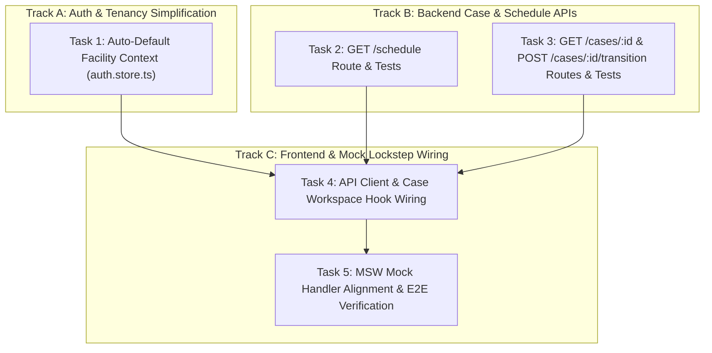

# P15c — Case Read, Schedule & Workspace Backend APIs

| Field | Value |
|---|---|
| Wave · Lane · Size | 3 · Clinical · S |
| Depends on | P15b (PR #79) |
| Unblocks | P17 (Pre-Op & Consent), P16 (H&P & Anticoagulation), P18 (Intra-Op Capture) |
| Source mix | Fastify 5 (`apps/api`) + Medplum FHIR R4 (`Appointment`, `Encounter`, `Patient`, `ServiceRequest`) + `@asc/api-client` + MSW mock handler alignment |
| Requirements | EP-C (Story C.1, C.2, C.3) & `[REQ-5:158-204]`, `[REQ-10:480-510]` |
| Status | 100% COMPLETE (PR #84, PR #85, PR #87 merged) |
| Branch | `phase/P15c-case-workspace-api` |

---

## 1. Goal

Provide the live read and transition backend APIs in `apps/api` for:
1. `GET /schedule` — Returns day-slate appointments, providers, rooms, and active statuses for a selected date and facility.
2. `GET /cases/:id` — Returns the fully hydrated Case Workspace bundle (Appointment, Encounter, Patient demographics, ServiceRequest, CareTeam, and current physical stage).
3. `POST /cases/:id/transition` — Validates and executes physical stage transitions (`arrived`, `preop`, `in_room`, `procedure_start`, `procedure_end`, `pacu`, `discharge_ready`, `discharged`), generating required `AuditEvent` logs and updating FHIR Encounter status.
4. Auto-default `facilityId` on login in `auth.store.ts` to eliminate disabled booking buttons.
5. Align MSW mock handlers in `apps/web/src/mocks/` in lockstep so both live and mock workflows execute identically.

---

## 2. File Structure

```text
apps/api/src/routes/schedule.ts                        NEW   GET /schedule (date, facilityId)
apps/api/src/routes/schedule.test.ts                   NEW   Unit & integration tests
apps/api/src/routes/cases.ts                           EDIT  Add GET /cases/:id & POST /cases/:id/transition
apps/api/src/routes/cases.test.ts                      EDIT  Test read and stage transitions
packages/api-client/src/cases.ts                       EDIT  Export getCase(), getSchedule(), transitionCase()
apps/web/src/lib/stores/auth.store.ts                  EDIT  Auto-default facilityId on login
apps/web/src/features/case/hooks/use-case.ts           EDIT  Wire useCase to @asc/api-client
apps/web/src/mocks/handlers/cases.ts                   EDIT  Align MSW mock handlers with live API contracts
```

---

## 3. Sub-Agent Task Decomposition & Dependency Matrix



| Task ID | Task Description | Dependencies | Can Run in Parallel With | Subagent Role | Deliverable |
|---|---|---|---|---|---|
| **T1** | Auto-default `facilityId` in `auth.store.ts` and streamline navbar | None | T2, T3 | Frontend Engineer | Zero disabled buttons, seamless single-facility context |
| **T2** | Implement `GET /schedule` in `apps/api/src/routes/schedule.ts` | None | T1, T3 | Backend API Engineer | Date-filtered schedule slate endpoint |
| **T3** | Implement `GET /cases/:id` and `POST /cases/:id/transition` | None | T1, T2 | Healthcare FHIR Engineer | Hydrated case workspace read & stage advancement |
| **T4** | Wire `packages/api-client` and `apps/web/src/features/case/` | T1, T2, T3 | — | Fullstack Integrator | Case Workspace live against Fastify API |
| **T5** | Update MSW mock handlers and run end-to-end verification | T4 | — | QA & Verification Engineer | Green build, green tests, verified mock & live parity |

---

## 4. Acceptance Criteria

- [x] `GET /schedule?date=YYYY-MM-DD` returns 200 with all cases booked for the facility.
- [x] `GET /cases/:id` returns 200 with hydrated Case details (Patient, Appointment, Encounter, Stage).
- [x] `POST /cases/:id/transition` successfully transitions stage and logs `AuditEvent`.
- [x] "Book Case" button in `apps/web` is active immediately on login without manual switcher selection.
- [x] Visiting `/schedule` and `/cases/[caseId]` works identically with `NEXT_PUBLIC_API_MOCKING=enabled` and with live `apps/api`.
- [x] Strict type safety: Zero `any`, zero `unknown`.
- [x] 100% green tests across `apps/api`, `packages/api-client`, and `apps/web`.
