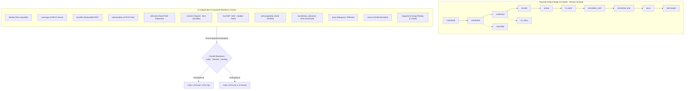
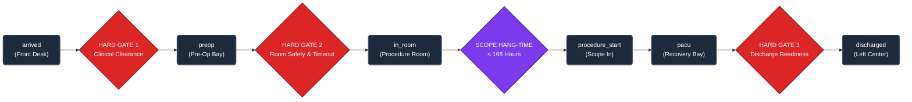

# Clinical Safety: Stage vs. Readiness Decoupling and the 3 Strict Hard Gates

> **Document:** `docs/product/09-clinical-safety-and-stage-readiness.md`  
> **Status:** Approved Architecture Specification (v1.0)  
> **Source Grounding:** Anurag Chatterjee's _ASC OS Requirements Document_ (REQ-5 §154–210, REQ-10, REQ-13) and _Master Build Specification_ (§6).  
> **Code Implementation:** `@asc/types` (`clinical.ts`), `@asc/clinical-rules` (`gates/`), `@asc/fhir` (`code-systems/`).

---

## 1. Executive Summary & The Problem

Traditional hospital EHRs collapse patient location, operational status, and clinical readiness into a monolithic enum (e.g. `Checked-In-Auth-Pending`, `Pre-Op-Consent-Missing`, `In-Room-HP-Expired`).

This pattern causes three catastrophic failure modes in an ambulatory surgery center:

1. **Combinatorial State Explosion:** 12 physical locations $\times$ 12 clinical/financial prerequisites creates over 144 synthetic statuses that break state machines and automated reasoning.
2. **False Operational Blocking:** An unverified commercial insurance deductible or pending authorization traps an arrived patient in the waiting room, delaying clinical preparation and causing schedule cascade failures.
3. **Waiver Ambiguity:** Staff inadvertently bypass clinical safety checks (e.g. unsigned consent or unconfirmed identity) when trying to push a case into the operating theatre under time pressure.

In **ASC EHR**, physical patient movement (**Stage**) is **completely decoupled** from computed clinical and administrative prerequisites (**Readiness**). Physical stage transitions are strictly governed by **Three Clinical Hard Gates** and a **Sterile Scope Hang-Time Lock**.

---

## 2. Core Architectural Principle: Decoupled Stage vs. Readiness

### 2.1 The 12 Physical Patient Stages (`CaseStage`)

A case stage represents **where the patient physically is or has been within the ASC facility**:

| Stage             | Description                                                 | Physical Location        | Transition Trigger     |
| ----------------- | ----------------------------------------------------------- | ------------------------ | ---------------------- |
| `requested`       | Referral intake or booking request received                 | Outside / Portal         | Referral triage        |
| `scheduled`       | Booked into a specific operating suite, date, and time slot | Calendar                 | Case booking           |
| `confirmed`       | Patient confirmed attendance and prep instructions          | Home                     | Outreach / SMS         |
| `arrived`         | Patient physically presented at reception desk              | Reception / Waiting Room | Front desk check-in    |
| `preop`           | Patient admitted into pre-op bay; IV and vitals underway    | Pre-Op Bay (1–8)         | **Hard Gate 1 passed** |
| `in_room`         | Patient wheeled into procedure suite; monitors attached     | OR Suite (1–4)           | **Hard Gate 2 passed** |
| `procedure_start` | Endoscope inserted into patient                             | Procedure Table          | Scope in timestamp     |
| `procedure_end`   | Endoscope withdrawn from patient                            | Procedure Table          | Scope out timestamp    |
| `pacu`            | Patient admitted to Phase 1/2 recovery                      | PACU Bay (1–6)           | Anesthesia hand-off    |
| `discharged`      | Patient released to confirmed responsible adult             | Facility Exit            | **Hard Gate 3 passed** |
| `cancelled`       | Procedure cancelled prior to arrival                        | N/A                      | Cancellation event     |
| `no_show`         | Patient failed to present on procedure day                  | N/A                      | No-show event          |

- **Directionality:** Forward movement is strictly sequential.
- **Stage Reversals:** If an in-room patient must return to pre-op (e.g. equipment failure or sudden hypertension), the transition is an explicit, audited reversal (`STAGE_REVERSALS` in `@asc/clinical-rules`) requiring a mandatory clinical justification.

---

### 2.2 The 12 Computed Readiness Checks (`ReadinessCheckName`)

Readiness checks are pure functional evaluations over FHIR resources and external state. They are **dynamically computed, never stored as static flags**:

| Check Name             | Category          | Evaluation Criteria                                                                          | Waivable?                       |
| ---------------------- | ----------------- | -------------------------------------------------------------------------------------------- | ------------------------------- |
| `identity`             | Clinical / Safety | Two-factor demographic verification (matched to FHIR `Patient`, Name + DOB verified).        | **STRICTLY NON-WAIVABLE**       |
| `consent`              | Legal / Safety    | Signed informed consent naming the specific planned procedure, physician, and risks.         | **STRICTLY NON-WAIVABLE**       |
| `coverage`             | Financial         | X12 271 active coverage response within 72 hours of procedure date.                          | Waivable (Self-pay / Emergency) |
| `benefits`             | Financial         | Deductible, copay, and coinsurance amounts parsed and stored.                                | Waivable                        |
| `authorization`        | Financial         | X12 278 prior authorization number on file and verified valid for procedure date.            | Waivable                        |
| `estimate`             | Financial         | Good-Faith Estimate delivered to patient $\ge 3$ business days prior (or at booking).        | Waivable                        |
| `hp`                   | Clinical          | H&P within 30 days of procedure date + signed pre-procedure interval update note.            | Clinician-only override         |
| `anticoagulation`      | Clinical          | Prescriber-confirmed hold window documented, or marked explicitly not applicable.            | Clinician-only override         |
| `anesthesia_clearance` | Clinical          | Pre-anesthesia evaluation documented with ASA physical status and Mallampati airway class.   | Clinician-only override         |
| `prep`                 | Clinical          | Bowel preparation adequacy evaluated (e.g. clear liquid effluent confirmed).                 | Clinician-only override         |
| `escort`               | Operational       | Confirmed responsible adult name and phone on file to transport patient home.                | Clinician-only override         |
| `equipment`            | Safety            | Primary endoscope serial assigned, sterile cycle verified, and hang-time $\le 168\text{ h}$. | **STRICTLY NON-WAIVABLE**       |

### 2.3 Non-Blocking Financial Readiness

Financial readiness checks (`coverage`, `benefits`, `authorization`, `estimate`) **never block physical stage progression**:

- When a patient arrives, missing insurance authorization routes an urgent `Task` to the Financial Clearance specialist (Dee).
- The patient continues through Gate 1 into the Pre-Op bay so clinical nursing preparation (IV, vitals, consent) proceeds without delay.
- Financial clearance is resolved in parallel while the patient is in pre-op.

---

## 3. The 3 Strict Clinical Hard Gates

Clinical Hard Gates are hard software barriers enforced in `apps/api` and `@asc/clinical-rules`. Case progression fails closed (HTTP 409 Conflict) if any mandatory gate requirement is not met.

---

### 3.1 Hard Gate 1: Arrived ➔ Pre-Op

Enforces the transition from the waiting room to the pre-operative clinical bay.

- **Enforced by:** `evaluateGate1()` in [`@asc/clinical-rules/gates/gate1.ts`](file:///Users/amananku/Documents/wybit/ASC_EHR/packages/clinical-rules/src/gates/gate1.ts).
- **Required Checks:**
  1. `identity`: Verified against positive photo ID and matched to the active `Patient` resource.
  2. `consent`: Informed consent electronically signed by the patient (or legal guardian) via tablet `SignaturePad`, capturing cryptographic sha256 hash.
  3. `hp`: History and Physical examination completed within 30 days of the procedure date, accompanied by a signed day-of interval note confirming no clinical changes.
  4. `npo`: Minimum fasting duration confirmed per institutional fasting protocol (e.g. 2h clear liquids, 6h light meal).
  5. `escort`: Responsible adult escort confirmed to accompany the patient home.
- **Non-Waivable Rule (REQ-5 §202 / AC-F-02-3):**
  > **`identity` and `consent` CANNOT be waived by ANY role, under ANY circumstance, including the Center Administrator or Medical Director.**
  > Attempts to submit waivers for identity or consent are rejected by the engine and logged as security audit anomalies.

---

### 3.2 Hard Gate 2: Pre-Op ➔ In-Room

Enforces safety before the patient enters the procedure suite.

- **Enforced by:** `evaluateGate2()` in [`@asc/clinical-rules/gates/gate2.ts`](file:///Users/amananku/Documents/wybit/ASC_EHR/packages/clinical-rules/src/gates/gate2.ts).
- **Required Checks:**
  1. `anesthesia_clearance`: Documented evaluation by CRNA or Anesthesiologist recording ASA Physical Status classification (I–IV) and Mallampati airway score (Class I–IV).
  2. `anticoagulation`: Anticoagulation and antiplatelet hold protocol clearance verified. Requires documented prescriber clearance for high-risk medications (Warfarin, Eliquis, Xarelto, Plavix) or explicit confirmation that patient is not on anticoagulation.
  3. `equipment`: Assigned endoscope serial verified as clean, leak-tested, and within the 168-hour hang-time window.
  4. `timeout`: Synchronous multi-role attestation in the procedure room naming all participating clinical staff (Gastroenterologist, Anesthesia/CRNA, RN Circulator) verifying patient identity, procedure, site, allergies, and fire risk.

---

### 3.3 Hard Gate 3: PACU ➔ Discharge

Governs safe discharge from the post-anesthesia care unit.

- **Required Checks:**
  1. `aldrete`: Modified Aldrete recovery score $\ge 9$ (or PADSS equivalent) with stable vital signs across standard interval measurements.
  2. `escort_verified`: Physical bedside presence of the verified responsible adult escort confirmed before the patient leaves the recovery stretcher.
  3. `signed_note`: Final procedure note signed by the endoscopist, or an immediate post-procedure note documenting operative findings, interventions, and complications.
  4. `discharge_instructions`: Printed and verbally explained post-procedure instructions, dietary restrictions, emergency telephone contacts, and anticoagulation restart schedule delivered to patient and escort.

---

## 4. Sterile Scope Reprocessing Hang-Time Hard Gate (168 Hours)

- **Enforced by:** `evaluateScopeHangTime()` in [`@asc/clinical-rules/gates/scope-hang-time.ts`](file:///Users/amananku/Documents/wybit/ASC_EHR/packages/clinical-rules/src/gates/scope-hang-time.ts).
- **Maximum Allowable Limit:** **168 hours (7 calendar days)** from the completion of the sterile reprocessing cycle.
- **Absolute Zero-Override Enforcement (REQ-13 / AC-I-05-4):**
  > If an endoscope's elapsed time from reprocessing exceeds 168 hours or its leak test failed, **no role (including Administrator) can override this lock**.
  > The scope is immediately quarantined in the inventory register and locked against procedure assignment until re-sterilized through high-level disinfection.

---

## 5. FHIR R4 Implementation & Storage Mapping

| Architectural Concept   | FHIR R4 Resource               | Mapping / Extension Details                                                                                                                                                          |
| ----------------------- | ------------------------------ | ------------------------------------------------------------------------------------------------------------------------------------------------------------------------------------ |
| **Case Stage**          | `Encounter.status` + Extension | Canonical CodeSystem: `https://fhir.wybit.io/asc/CodeSystem/case-stage` Mapped into normative FHIR status (`planned`, `arrived`, `in-progress`, `finished`).                      |
| **Readiness Check**     | `Observation`                  | Category: `exam` CodeSystem: `https://fhir.wybit.io/asc/CodeSystem/case-readiness-check` `Observation.valueCodeableConcept`: `satisfied` \| `pending` \| `failed` \| `waived`. |
| **Waiver Provenance**   | `Provenance` + Extension       | Stored with `agent.who` (practitioner), `recorded` (ISO timestamp), and `extension:waiver-justification` containing clinical reasoning.                                              |
| **Consent Attestation** | `Consent` + `Provenance`       | `Consent.provision` links planned procedure code; `Provenance.signature` records sha256 digest of signed PDF and signature stroke coordinate vector.                                 |
| **Scope Reprocessing**  | `DeviceMetric` / `Observation` | Tracks serial number, leak test outcome, high-level disinfection cycle timestamp, and computed hang-time expiry.                                                                     |

---

## 6. Verification & Quality Gates

All gate logic is pure, deterministic, and covered by automated test suites in `@asc/clinical-rules`:

- `gate1.test.ts`: Golden verification of `evaluateGate1`, non-waivable rules, and H&P validity intervals.
- `gate2.test.ts`: Verification of `evaluateGate2`, anesthesia clearance, and timeout attestation.
- `scope-hang-time.test.ts`: Verification of `evaluateScopeHangTime` across boundary conditions (167h 59m vs 168h 01m) and zero-override lockdown.
