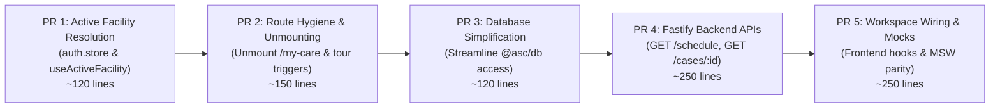

# Phase 2 Streamlining, Single-Facility Auth & P15c Case Workspace Plan

> **For agentic workers:** REQUIRED SUB-SKILL: Use superpowers:subagent-driven-development (recommended) or superpowers:executing-plans to implement this plan task-by-task. Steps use checkbox (`- [ ]`) syntax for tracking.

**Goal:** Streamline the ASC EHR codebase for Day-1 single-facility operations (unmount dormant Phase 2 UI routes, auto-resolve `facilityId`, simplify database session hooks while preserving `facility_id` and all code), implement live P15c backend APIs (`GET /schedule`, `GET /cases/:id`, `POST /cases/:id/transition`), and achieve 100% lockstep parity between the live API and MSW mocks.

**Architecture:** Operates as a single-specialty GI ASC (Place of Service 24). Preserves `facility_id` on all database tables and FHIR `meta.accounts` for Phase 2 multi-site growth while removing runtime Postgres RLS session hooks. Unmounts dormant Phase 2 screens from Next.js 16 App Router (excluding them from build bundles without deleting files), while maintaining MSW mock handlers in lockstep with Fastify 5 endpoints.

**Tech Stack:** Fastify 5, Next.js 16 App Router, Medplum 5.1.42 (FHIR R4 & IdP), PostgreSQL (Drizzle ORM), TanStack Query v5, Zustand, MSW, Vitest.

**Spec:** `docs/plan/phases/P15c-case-workspace-api.md` · `docs/decisions/2026-10-14-single-facility-progressive-mounting-and-mock-alignment.md` · `scratch/requirements_document.md` · `scratch/build_specification.md`

---

## Global Constraints

- Absolute ban on `any` and `unknown` types across all packages (strict TypeScript).
- No code deletions of Phase 2 features: preserve all components in `apps/web/src/features/portal/` and `apps/web/src/features/guide/`.
- Every database row and FHIR resource MUST retain `facility_id` and `meta.accounts = ["Organization/<facilityId>"]`.
- Commits must be atomic, ≤ 400 changed lines, with conventional commit messages (`feat:`, `fix:`, `refactor:`, `test:`).
- Mocks and live endpoints must remain in strict lockstep parity.

---

## Review Focus

1. **`facilityId` Null Trap:** Signing in with global scope must immediately resolve the default facility context so booking buttons are never disabled on mount.
2. **Missing Stage Transition Timestamp:** Case transitions without `phaseEnteredAt` must not trap procedure rooms in permanent turnover.
3. **Date-Bounded Schedule Queries:** Schedule searches must be strictly date-bounded (`ge${startOfDay}` and `le${endOfDay}`) to prevent unbounded queries.
4. **Unmounted Route Tree-Shaking:** Ensure unmounting `/my-care` produces zero TypeScript errors and compiles cleanly without bundling unneeded portal assets.
5. **MSW vs. Live API Contract Mismatch:** Ensure response shapes for `GET /cases/:id` and `GET /schedule` in `apps/api` match `apps/web/src/mocks/handlers/` byte-for-byte.

---

## Phase-Wise PR Breakdown (Small, Context-Bounded Deliverables)

To ensure maximum agent reasoning quality, avoid context saturation, and adhere strictly to the repo's **≤ 400 lines per commit/PR rule**, this work is decomposed into **5 independent, bite-sized PR phases**:



| PR Phase | Branch Name | Scope & Deliverable | Target Size | Verification Gate |
|---|---|---|---|---|
| **PR 1: Auth Facility Context** | `feat/auth-resolve-active-facility` | Implement `resolveActiveFacility()`, `useActiveFacility()` hook, hide switcher when single site, regression tests. | ~120 lines | `pnpm --filter @asc/web test auth.store.test.ts` |
| **PR 2: Route Unmounting** | `feat/unmount-dormant-portal-routes` | Unmount `/my-care` and tour triggers while preserving all code in `src/features/portal/` and `src/features/guide/`. | ~150 lines | `pnpm --filter @asc/web check-types test` |
| **PR 3: DB Streamlining** | `feat/db-streamline-access` | Remove connection-pinned `set_config('app.tenant_id')` hook in `@asc/db`, retaining `facility_id` on all tables. | ~120 lines | `pnpm --filter @asc/db test` |
| **PR 4: Backend APIs (P15c.1)** | `feat/api-schedule-and-case-routes` | Implement `GET /schedule`, `GET /cases/:id`, and `POST /cases/:id/transition` in `apps/api`. | ~250 lines | `pnpm --filter @asc/api test` |
| **PR 5: UI & Mocks (P15c.2)** | `feat/case-workspace-wiring-and-mocks` | Wire `useSchedule` & `useCase` to `@asc/api-client`, align MSW handlers in lockstep, e2e test. | ~250 lines | Full monorepo `lint check-types test` |

---

## Detailed Task Specifications

### Task 1: Robust Active Facility Resolution & `useActiveFacility` Hook
**Files:**
- Create: `apps/web/src/hooks/use-active-facility.ts`
- Modify: `apps/web/src/lib/stores/auth.store.ts`
- Modify: `apps/web/src/components/shell/app-header.tsx`
- Test: `apps/web/src/lib/stores/auth.store.test.ts`
- Test: `apps/web/src/hooks/use-active-facility.test.ts`

**Architecture Principle (Separation of Concerns):**
- **Grants** answer: *"What can you do?"* (Capabilities & Role).
- **`me.facilities`** answers: *"Where are you authorized to work?"* (Facility memberships).
- `me.facilities` is the **sole source of truth** for accessible work locations. Do not derive active working facility from `grantedFacilityIds()`.

- [x] **Step 1: Write failing regression test in `auth.store.test.ts`**
  Verify that when an admin user logs in with `scope: "all"` and `me.facilities = [{ id: "org-1", name: "Metro GI ASC" }]`, `resolveActiveFacility(me)` resolves to `"org-1"` and is never `null`.
- [x] **Step 2: Implement `resolveActiveFacility(me, persistedId)` in `auth.store.ts`**
  ```ts
  export function resolveActiveFacility(
    facilities: readonly { readonly id: string; readonly name: string }[],
    persistedId?: string | null,
    defaultFacilityId?: string | null
  ): string | null {
    const validIds = facilities.map((f) => f.id);
    if (persistedId && validIds.includes(persistedId)) return persistedId;
    if (defaultFacilityId && validIds.includes(defaultFacilityId)) return defaultFacilityId;
    return validIds[0] ?? null;
  }
  ```
- [x] **Step 3: Implement `useActiveFacility()` hook**
  In `apps/web/src/hooks/use-active-facility.ts`, export a hook that returns `{ activeFacilityId, facility, hasFacility: boolean }`. If `facilityId` is `null` (misconfigured account with zero facilities), return a clear blocked status so components render a *"No facility assigned. Please contact your center administrator"* state rather than propagating a nullable ID to mutation forms.
- [x] **Step 4: Hide manual `FacilitySwitcher` when single facility exists**
  In `app-header.tsx`, render `FacilitySwitcher` only when `facilities.length > 1`.
- [x] **Step 5: Run tests to verify pass**
  Run: `pnpm --filter @asc/web test auth.store.test.ts`
- [x] **Step 6: Commit**
  Commit: `fix(web): resolve active facility from me.facilities and add useActiveFacility hook`

---

### Task 2: Unmount Dormant Phase 2 Routes
**Files:**
- Move: `apps/web/src/app/(dashboard)/my-care/page.tsx` -> `apps/web/src/app/(dashboard)/_my-care/page.tsx`
- Modify: `apps/web/src/components/shell/nav-config.ts`
- Modify: `apps/web/src/lib/workspaces.ts`
- Modify: `apps/web/src/lib/personas.ts`
- Test: `apps/web/src/components/shell/nav-config.test.ts`

- [x] **Step 1: Write failing test in `nav-config.test.ts`**
  Assert that navigation items for clinical staff do not include `/my-care` or portal self-read links.
- [x] **Step 2: Run test to verify failure**
  Run: `pnpm --filter @asc/web test nav-config.test.ts`
- [x] **Step 3: Unmount route and navigation links**
  Prefix the directory with underscore `_my-care` so Next.js ignores it. Remove `my-care` entries from `NAV_ITEMS` and `workspaces.ts`. Remove `demo-patient` from `PERSONAS`.
- [x] **Step 4: Verify test passes and build succeeds**
  Run: `pnpm --filter @asc/web test && pnpm --filter @asc/web check-types`
- [x] **Step 5: Commit**
  Commit: `refactor(web): unmount dormant patient portal routes while preserving features`

---

### Task 3: Streamline `@asc/db` (Remove `withTenant` RLS Session Hook)
**Files:**
- Modify: `packages/db/src/tenant.ts`
- Modify: `packages/db/src/audit-store.ts`
- Test: `packages/db/src/tenant.test.ts`

- [x] **Step 1: Write test verifying direct parameterized queries**
  Ensure database queries execute directly using standard Drizzle transactions without invoking `SELECT set_config('app.tenant_id', ...)`.
- [x] **Step 2: Run test to verify behavior**
  Run: `pnpm --filter @asc/db test`
- [x] **Step 3: Update `tenant.ts` to export direct query interface**
  Preserve `tenant_id` and `facility_id` columns in schemas, but allow `withTenant` to execute without the Postgres session hook.
- [x] **Step 4: Update `audit-store.ts` to default `facility_id` / `tenant_id` without throwing `AuditTenantMissingError`**
- [x] **Step 5: Run tests and commit**
  Commit: `refactor(db): streamline query execution removing connection-pinned session hooks`

---

### Task 4: Implement `GET /schedule` in Fastify (`apps/api`)
**Files:**
- Create: `apps/api/src/routes/schedule.ts`
- Test: `apps/api/src/routes/schedule.test.ts`
- Modify: `apps/api/src/routes/index.ts`

- [x] **Step 1: Write failing integration test for `GET /schedule`**
  Verify `GET /schedule?date=2026-10-14&facilityId=org-1` returns HTTP 200 with date-bounded appointments and encounters.
- [x] **Step 2: Run test to verify failure**
  Run: `pnpm --filter @asc/api test schedule.test.ts`
- [x] **Step 3: Implement `GET /schedule` handler**
  Query Medplum for Appointments with date bounds (`ge${startOfDayIso}`, `le${endOfDayIso}`) and resolve associated patient displays and procedure names using shared defaults from `@asc/clinical-rules`.
- [x] **Step 4: Run test to verify pass**
  Run: `pnpm --filter @asc/api test schedule.test.ts`
- [x] **Step 5: Commit**
  Commit: `feat(api): implement date-bounded GET /schedule endpoint`

---

### Task 5: Implement `GET /cases/:id` and `POST /cases/:id/transition`
**Files:**
- Modify: `apps/api/src/routes/cases.ts`
- Test: `apps/api/src/routes/cases.test.ts`

- [x] **Step 1: Write failing integration tests**
  Test `GET /cases/:id` returns hydrated Case bundle. Test `POST /cases/:id/transition` validates stage progression and writes `AuditEvent`.
- [x] **Step 2: Run tests to verify failure**
  Run: `pnpm --filter @asc/api test cases.test.ts`
- [x] **Step 3: Implement `GET /cases/:id`**
  Read Encounter, Appointment, Patient, and ServiceRequest in parallel; compute current physical stage and return structured Case detail.
- [x] **Step 4: Implement `POST /cases/:id/transition`**
  Validate target stage transition against allowed transitions; update Encounter status; record transition timestamp and audit event.
- [x] **Step 5: Run tests and commit**
  Commit: `feat(api): implement case read and stage transition endpoints`

---

### Task 6: Wire Case Workspace & Schedule to Live API Client
**Files:**
- Modify: `packages/api-client/src/cases.ts`
- Modify: `apps/web/src/features/case/hooks/use-case.ts`
- Modify: `apps/web/src/features/schedule/hooks/use-schedule.ts`
- Test: `packages/api-client/src/cases.test.ts`

- [x] **Step 1: Export API client methods `getCase(id)` and `getSchedule(date, facilityId)`**
- [x] **Step 2: Wire `useCase` and `useSchedule` in `apps/web`**
  Connect React Query hooks to `@asc/api-client`.
- [x] **Step 3: Verify Case Workspace (`/cases/[caseId]`) loads live case data**
- [x] **Step 4: Commit**
  Commit: `feat(web): wire case workspace and schedule hooks to api client`

---

### Task 7: Align MSW Mock Handlers & Parity Verification
**Files:**
- Modify: `apps/web/src/mocks/handlers/cases.ts`
- Modify: `apps/web/src/mocks/handlers/schedule.ts`
- Test: `apps/web/src/mocks/handlers.test.ts`

- [x] **Step 1: Synchronize MSW mock response schemas with `apps/api` contracts**
- [x] **Step 2: Verify both mock mode (`NEXT_PUBLIC_API_MOCKING=enabled`) and live API mode function identically**
- [x] **Step 3: Run full web tests**
  Run: `pnpm --filter @asc/web test`
- [x] **Step 4: Commit**
  Commit: `test(web): synchronize msw mock handlers with live api contracts`

---

### Task 8: Full Monorepo Typecheck, Lint & Integration Gate
- [x] **Step 1: Run turbo lint across all workspaces**
  Run: `pnpm turbo run lint`
- [x] **Step 2: Run turbo check-types across all workspaces**
  Run: `pnpm turbo run check-types`
- [x] **Step 3: Run all test suites across all packages**
  Run: `pnpm turbo run test`
- [x] **Step 4: Update `PROGRESS.md` with P15c completion**
- [x] **Step 5: Commit and finalize PR**
  Commit: `chore: verify type safety, linting, and tests across monorepo`
