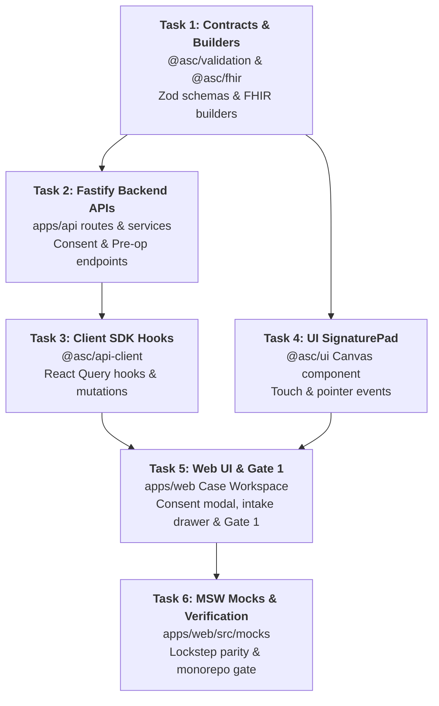

# P17 — Pre-Op Nursing, Digital Tablet Consent & Hard Gate 1 Implementation Plan

> **For agentic workers:** REQUIRED SUB-SKILL: Use superpowers:subagent-driven-development (recommended) or superpowers:executing-plans to implement this plan task-by-task. Steps use checkbox (`- [ ]`) syntax for tracking.

**Goal:** Implement digital tablet touchscreen informed consent capture (`SignaturePad`), pre-op bay nursing assessment (vitals, IV placement, NPO status, escort verification), and enforce clinical Hard Gate 1 (`arrived` ➔ `preop`) across `@asc/validation`, `apps/api`, `@asc/api-client`, `@asc/ui`, and `apps/web`, maintaining byte-for-byte lockstep with MSW mocks.

**Architecture:** Operates on the decoupled Stage vs. Readiness state machine (REQ-5, EP-E, EP-F). Captures informed consent as a FHIR `Consent` resource linked to `Encounter/${caseId}` with cryptographic signature hash attestation. Pre-op vitals and IV placement are recorded as discrete FHIR `Observation`s and nursing records. Hard Gate 1 transition (`arrived` ➔ `preop`) strictly validates `identity`, `consent`, and `hp` via `@asc/clinical-rules` `evaluateGate1`, rejecting any attempted waiver of identity or consent with HTTP 409 `GATE_FAILED`.

**Tech Stack:** Fastify 5, React 19 / Next.js 16 App Router, HTML5 Canvas, Medplum 5.1.42 (FHIR R4), TanStack Query v5, Zod, Tailwind CSS v4, MSW 2.x, Vitest.

**Spec:** `docs/plan/phases/P17-preop-consent.md` · `scratch/build_specification.md` (US-E-09, US-F-02, US-F-03, US-M-03) · `scratch/requirements_document.md` (REQ-5, REQ-9, REQ-10).

---

## Global Constraints

- Absolute ban on `any` and `unknown` types across all packages and apps (strict TypeScript).
- Commits must be atomic, ≤ 400 changed lines, with conventional commit messages (`feat:`, `fix:`, `test:`, `refactor:`).
- `identity` and `consent` readiness checks can NEVER be waived by any role, including administrator (AC-D-12-4, AC-F-02-3).
- No AI agent may sign consent or pass Hard Gate 1 (US-M-03, AC-M-03-1, AC-M-03-2).
- Zero lint warnings (`eslint --max-warnings 0`) and clean typecheck (`tsc --noEmit`).
- MSW mock handlers in `apps/web/src/mocks/` must remain in 100% byte-for-byte lockstep parity with Fastify 5 endpoints.
- Work-in-progress nursing data must survive interruption or accidental navigation (AC-F-03-4, NFR-14).
- Touch targets on clinical screens must be ≥ 44px for gloved and tablet operation (NFR-11).

---

## Review Focus

1. **Blank / Empty Signature Submission:** Submitting consent without drawing on the canvas (empty or transparent PNG data URL) must be rejected with HTTP 400 `"Patient signature is required"`.
   - *Test:* `packages/validation/src/consent.test.ts` verifies `signConsentSchema` rejects empty or transparent data URLs.
2. **Procedure Mismatch Rejection:** If consent is signed for a procedure that differs from the scheduled procedure (e.g. "EGD" instead of "Colonoscopy with Polypectomy"), the `consent` readiness check must evaluate to `failed` (AC-E-09-2).
   - *Test:* `apps/api/src/routes/consent.test.ts` asserts signing consent with divergent procedure codes flags `consent` check as failed.
3. **Waiver Lockout at Gate 1:** Attempting to transition from `arrived` to `preop` with `consent` or `identity` marked as `"waived"` must be rejected with HTTP 409 `GATE_FAILED` and reason code `GATE1_CONSENT` (AC-F-02-3, AC-D-12-4).
   - *Test:* `apps/api/src/routes/cases.test.ts` asserts Gate 1 rejects transitions where consent was attempted to be waived.
4. **NPO Violation Detection:** Pre-op nursing assessment recording solid food intake within 6 hours or clear liquids within 2 hours must evaluate the `prep`/`npo` readiness check to `failed` and warn the nurse.
   - *Test:* `packages/validation/src/preop.test.ts` and `apps/api/src/routes/preop.test.ts` verify NPO hour bounds.
5. **Session Interruption Recovery:** Pre-op nursing vitals entered partially into the bedside form must survive accidental tab switching or component unmounting via local draft state (AC-F-03-4, NFR-14).
   - *Test:* `apps/web/src/features/case/preop-flow.test.tsx` verifies draft persistence across unmount/remount.

---

## File Structure & Module Responsibilities

```text
packages/validation/src/
  ├── consent.ts                                NEW   Zod schemas for consent signing & verification
  ├── consent.test.ts                           NEW   Unit tests for consent validation rules
  ├── preop.ts                                  NEW   Zod schemas for pre-op vitals, IV, NPO, escort
  ├── preop.test.ts                             NEW   Unit tests for pre-op nursing inputs
  └── index.ts                                  EDIT  Export consent and preop schemas and types

packages/fhir/src/
  ├── builders/consent.ts                       NEW   Pure FHIR R4 Consent resource builder
  ├── builders/preop.ts                         NEW   Pure FHIR R4 Observation & Nursing Note builders
  ├── builders/consent.test.ts                  NEW   Unit tests for FHIR Consent generation
  └── index.ts                                  EDIT  Export consent and preop builders

apps/api/src/
  ├── routes/cases.ts                           EDIT  Mount POST /cases/:caseId/consent & POST /cases/:caseId/preop
  ├── routes/consent.test.ts                    NEW   Integration tests for live Fastify consent endpoint
  ├── routes/preop.test.ts                      NEW   Integration tests for pre-op nursing endpoint
  ├── services/consent-service.ts               NEW   FHIR Consent persistence & readiness check update
  └── services/preop-service.ts                 NEW   Vitals Observations, IV record & NPO/escort sync

packages/api-client/src/
  ├── cases.ts                                  EDIT  Add signConsent() and submitPreopAssessment()
  ├── react/hooks.ts                            EDIT  Export useConsent() query hook
  ├── react/mutation.ts                         EDIT  Export useSignConsent() & useSubmitPreop() mutations
  └── consent.test.ts                           NEW   Unit tests for API client consent methods

packages/ui/src/
  ├── components/signature-pad/signature-pad.tsx NEW   HTML5 Canvas signature component (touch + pen + mouse)
  ├── components/signature-pad/signature-pad.test.tsx NEW Unit tests for signature canvas interactions
  └── index.ts                                  EDIT  Export SignaturePad component

apps/web/src/
  ├── features/case/components/
  │     ├── consent-modal.tsx                   NEW   Touchscreen Informed Consent modal with SignaturePad
  │     ├── preop-intake-drawer.tsx             NEW   Pre-op Bay assessment (vitals, IV, NPO, escort)
  │     ├── gate-blocker-alert.tsx              NEW   Displays structured 409 Gate 1 conflict reasons
  │     └── stage-stepper.tsx                   EDIT  Wire Gate 1 advance button with Gate 1 validation
  ├── features/case/case-workspace.tsx          EDIT  Integrate consent and pre-op action buttons
  └── mocks/
        ├── handlers/cases.ts                   EDIT  Align MSW mock handlers for consent and pre-op
        ├── db/store.ts                         EDIT  Support consent state and readiness check updates
        └── handlers/cases.test.ts              EDIT  Integration test for mock consent & Gate 1 advance
```

---

## Sub-Agent Task Decomposition



---

### Task 1: Validation Contracts & FHIR Builders for Consent and Pre-Op

**Files:**
- Create: `packages/validation/src/consent.ts`
- Create: `packages/validation/src/consent.test.ts`
- Create: `packages/validation/src/preop.ts`
- Create: `packages/validation/src/preop.test.ts`
- Create: `packages/fhir/src/builders/consent.ts`
- Create: `packages/fhir/src/builders/preop.ts`
- Create: `packages/fhir/src/builders/consent.test.ts`
- Modify: `packages/validation/src/index.ts`
- Modify: `packages/fhir/src/index.ts`

**Interfaces:**
- Consumes: `@asc/types` (`Consent`, `ConsentKind`, `VitalsEntry`, `StaffRef`, `IsoDateTime`).
- Produces:
  ```ts
  export const signConsentSchema: z.ZodType<SignConsentInput>;
  export interface SignConsentInput {
    readonly caseId: string;
    readonly procedureName: string;
    readonly procedureCode: string;
    readonly performingPhysicianName: string;
    readonly signerName: string;
    readonly signerRelationship: "patient" | "legal_guardian" | "healthcare_proxy";
    readonly signatureDataUrl: string; // Base64 data:image/png;base64,...
    readonly consentFormVersion: string;
    readonly risksAcknowledged: true;
    readonly facilityId: string;
  }

  export const preopAssessmentSchema: z.ZodType<PreopAssessmentInput>;
  export interface PreopAssessmentInput {
    readonly caseId: string;
    readonly facilityId: string;
    readonly vitals: {
      readonly sbp: number;
      readonly dbp: number;
      readonly hr: number;
      readonly rr: number;
      readonly spo2: number;
      readonly tempC: number;
      readonly heightInches?: number;
      readonly weightLbs?: number;
    };
    readonly iv: {
      readonly site: "left_hand" | "right_hand" | "left_forearm" | "right_forearm" | "left_ac" | "right_ac";
      readonly gauge: 18 | 20 | 22;
      readonly attempts: number;
    };
    readonly npo: {
      readonly solidFoodHoursAgo: number;
      readonly clearLiquidsHoursAgo: number;
      readonly confirmed: boolean;
    };
    readonly escort: {
      readonly name: string;
      readonly phone: string;
      readonly relationship: string;
      readonly confirmedPresent: boolean;
    };
    readonly allergiesReviewed: true;
    readonly belongingsSecured: boolean;
  }
  ```

- [ ] **Step 1: Write failing validation tests in `packages/validation/src/consent.test.ts` and `preop.test.ts`**
  Assert rejection of:
  - Empty or purely transparent `signatureDataUrl`.
  - Missing `risksAcknowledged` or `risksAcknowledged: false`.
  - SBP < 50 or > 300, DBP < 30 or > 200, SpO2 < 50 or > 100.
  - Non-numeric or invalid phone formats for escort.
- [ ] **Step 2: Run tests to verify failure**
  Run: `pnpm --filter @asc/validation test`
- [ ] **Step 3: Implement `packages/validation/src/consent.ts` and `preop.ts`**
  Implement strict Zod schemas with regex checks for `data:image/png;base64,` and bounds checks for physiological vitals.
- [ ] **Step 4: Implement FHIR R4 builders in `packages/fhir/src/builders/consent.ts` and `preop.ts`**
  - `buildConsentResource()`: Generates FHIR `Consent` resource with `status: "active"`, `scope: { coding: [{ system: "http://terminology.hl7.org/CodeSystem/consentscope", code: "treatment" }] }`, `category: [{ coding: [{ system: "http://loinc.org", code: "59284-0", display: "Consent Document" }] }]`, and cryptographic hash `sha256(signatureDataUrl)` stored in an extension.
  - `buildPreopObservationsBundle()`: Generates LOINC-coded `Observation` resources for vitals (8480-6 SBP, 8462-4 DBP, 8867-4 HR, 9279-1 RR, 2708-6 SpO2, 8310-5 Temp).
- [ ] **Step 5: Run tests to verify pass**
  Run: `pnpm --filter @asc/validation test && pnpm --filter @asc/fhir test`
- [ ] **Step 6: Commit**
  ```bash
  git add packages/validation packages/fhir
  git commit -m "feat(validation): define consent and preop intake contracts and fhir builders"
  ```

---

### Task 2: Fastify Backend APIs for Consent & Pre-Op Assessment (`apps/api`)

**Files:**
- Create: `apps/api/src/services/consent-service.ts`
- Create: `apps/api/src/services/preop-service.ts`
- Modify: `apps/api/src/routes/cases.ts`
- Create: `apps/api/src/routes/consent.test.ts`
- Create: `apps/api/src/routes/preop.test.ts`

**Interfaces:**
- Consumes: Task 1 schemas and FHIR builders, `request.medplum`, `app.guards.requireCapabilityAt`.
- Produces:
  - `POST /cases/:caseId/consent` ➔ HTTP 200 `{ ok: true, consent: Consent, readiness: CaseReadiness }`
  - `POST /cases/:caseId/preop-assessment` ➔ HTTP 200 `{ ok: true, vitals: VitalsEntry, readiness: CaseReadiness }`
  - `GET /cases/:caseId/consent` ➔ HTTP 200 `Consent | null`

- [ ] **Step 1: Write failing integration tests for `/cases/:caseId/consent` and `/cases/:caseId/preop-assessment`**
  - Verify `POST /cases/:caseId/consent` requires capability `clinical.document` or `consent.sign`.
  - Verify that when consent is signed, the `consent` check in `detail.case.readinessChecks` transitions to `"satisfied"`.
  - Verify that when pre-op assessment has solid food hours < 6, `prep`/`npo` evaluates to `"failed"`.
  - Verify that after valid consent and pre-op, `evaluateGate1` passes.
- [ ] **Step 2: Run tests to verify failure**
  Run: `pnpm --filter @asc/api test consent.test.ts preop.test.ts`
- [ ] **Step 3: Implement `consent-service.ts`**
  - Resolves Case `Encounter` and `Patient`.
  - Verifies procedure name in consent matches `Encounter.serviceType` or `ServiceRequest.code`; flags `consent` as failed if mismatched (AC-E-09-2).
  - Creates FHIR `Consent` resource via `medplum.createResource("Consent", ...)`.
  - Appends/updates `ReadinessCheck` for `consent`: `{ name: "consent", status: "satisfied", details: "Signed by " + signerName, satisfiedAt: nowIso }`.
  - Emits tamper-proof audit event `AuditEvent` (NFR-4).
- [ ] **Step 4: Implement `preop-service.ts`**
  - Writes LOINC Observation bundle to Medplum.
  - Updates `Encounter.extension` for pre-op vitals and IV placement.
  - Updates `ReadinessCheck` for `escort` (`"satisfied"` if escort confirmed, else `"pending"`).
  - Updates `ReadinessCheck` for `npo` (`"satisfied"` if solid >= 6h & clear >= 2h, else `"failed"`).
- [ ] **Step 5: Mount endpoints in `apps/api/src/routes/cases.ts`**
  Route pattern:
  `app.post("/cases/:caseId/consent", ...)`
  `app.post("/cases/:caseId/preop-assessment", ...)`
- [ ] **Step 6: Run tests and commit**
  Run: `pnpm --filter @asc/api test`
  ```bash
  git add apps/api/src/services apps/api/src/routes
  git commit -m "feat(api): implement consent signing and pre-op assessment endpoints"
  ```

---

### Task 3: Client SDK Methods & React Query Hooks in `@asc/api-client`

**Files:**
- Modify: `packages/api-client/src/cases.ts`
- Modify: `packages/api-client/src/react/hooks.ts`
- Modify: `packages/api-client/src/react/mutation.ts`
- Modify: `packages/api-client/src/index.ts`
- Create: `packages/api-client/src/consent.test.ts`

**Interfaces:**
- Consumes: Task 1 types, `http` client from `@asc/api-client/http`.
- Produces:
  - `signConsent(caseId, payload, facilityId)`
  - `submitPreopAssessment(caseId, payload, facilityId)`
  - `useSignConsent(caseId, facilityId)` (Mutation hook)
  - `useSubmitPreopAssessment(caseId, facilityId)` (Mutation hook)

- [ ] **Step 1: Write unit tests in `packages/api-client/src/consent.test.ts`**
  Verify `signConsent` calls `POST /cases/:caseId/consent` with `x-facility-id` header and payload.
- [ ] **Step 2: Run test to verify failure**
  Run: `pnpm --filter @asc/api-client test consent.test.ts`
- [ ] **Step 3: Implement client methods in `cases.ts`**
  Export `signConsent` and `submitPreopAssessment` using `http.post()`.
- [ ] **Step 4: Implement mutation hooks in `packages/api-client/src/react/mutation.ts`**
  Create `useSignConsent` and `useSubmitPreopAssessment` invalidating `queryKeys.cases.detail(caseId)` and `queryKeys.schedule.all` on success.
- [ ] **Step 5: Run tests to verify pass**
  Run: `pnpm --filter @asc/api-client test`
- [ ] **Step 6: Commit**
  ```bash
  git add packages/api-client
  git commit -m "feat(api-client): add signConsent and submitPreopAssessment mutations"
  ```

---

### Task 4: Interactive Touchscreen `SignaturePad` in `@asc/ui`

**Files:**
- Create: `packages/ui/src/components/signature-pad/signature-pad.tsx`
- Create: `packages/ui/src/components/signature-pad/signature-pad.test.tsx`
- Modify: `packages/ui/src/index.ts`

**Interfaces:**
- Consumes: Native HTML5 Canvas, React 19 pointer events.
- Produces:
  ```tsx
  export interface SignaturePadProps {
    readonly onSignatureChange: (dataUrl: string | null) => void;
    readonly width?: number | string;
    readonly height?: number;
    readonly penColor?: string;
    readonly clearLabel?: string;
    readonly disabled?: boolean;
    readonly className?: string;
  }
  export function SignaturePad(props: SignaturePadProps): React.JSX.Element;
  ```

- [ ] **Step 1: Write component unit test in `signature-pad.test.tsx`**
  Test initial empty state, clear button resetting canvas, and emission of data URL on stroke end.
- [ ] **Step 2: Run test to verify failure**
  Run: `pnpm --filter @asc/ui test signature-pad.test.tsx`
- [ ] **Step 3: Implement `SignaturePad` component**
  - Uses `useRef<HTMLCanvasElement>` with devicePixelRatio high-DPI resolution.
  - Implements smooth Bezier curves or line interpolation on `pointerdown`, `pointermove`, `pointerup`.
  - Supports touch-action: none so page scrolling does not interfere with drawing on tablets.
  - Renders Clear button with min 44px touch target (NFR-11).
  - Calls `onSignatureChange(dataUrl)` on `pointerup`.
- [ ] **Step 4: Run tests to verify pass**
  Run: `pnpm --filter @asc/ui test signature-pad.test.tsx`
- [ ] **Step 5: Commit**
  ```bash
  git add packages/ui
  git commit -m "feat(ui): implement touchscreen SignaturePad component"
  ```

---

### Task 5: Pre-Op Intake, Digital Consent Modal & Gate 1 in `apps/web`

**Files:**
- Create: `apps/web/src/features/case/components/consent-modal.tsx`
- Create: `apps/web/src/features/case/components/preop-intake-drawer.tsx`
- Create: `apps/web/src/features/case/components/gate-blocker-alert.tsx`
- Modify: `apps/web/src/features/case/case-workspace.tsx`
- Modify: `apps/web/src/features/case/components/stage-stepper.tsx`
- Create: `apps/web/src/features/case/consent-flow.test.tsx`
- Create: `apps/web/src/features/case/preop-flow.test.tsx`

**Interfaces:**
- Consumes: `@asc/ui` `SignaturePad`, `Button`, `Dialog`, `Drawer`; `@asc/api-client` `useSignConsent`, `useSubmitPreopAssessment`, `useCaseCommand`.
- Produces: Full interactive Pre-Op intake experience in Case Workspace.

- [ ] **Step 1: Write integration tests in `consent-flow.test.tsx` and `preop-flow.test.tsx`**
  - Verify clicking "Sign Informed Consent" opens modal with procedure name and performing physician.
  - Verify submitting consent updates the badge to "Signed" and turns readiness check green.
  - Verify clicking "Advance to Pre-Op" when consent is missing triggers HTTP 409 and displays `GateBlockerAlert` with missing requirements.
  - Verify after consent and pre-op vitals are saved, clicking "Advance to Pre-Op" transitions stage to `preop`.
- [ ] **Step 2: Run tests to verify failure**
  Run: `pnpm --filter @asc/web test consent-flow.test.tsx`
- [ ] **Step 3: Implement `ConsentModal` (`consent-modal.tsx`)**
  - Displays legal consent wording: *"I authorize Dr. {physicianName} to perform {procedureName}. The risks including bleeding, perforation, infection, and reaction to anesthesia have been explained..."*
  - Renders `SignaturePad`.
  - Captures signer name and relationship.
  - Submits via `useSignConsent()` mutation.
- [ ] **Step 4: Implement `PreopIntakeDrawer` (`preop-intake-drawer.tsx`)**
  - Vitals grid: BP, HR, RR, SpO2, Temp (validated with physiological ranges).
  - IV placement: site selector, gauge segmented control.
  - NPO check & Escort contact inputs.
  - Auto-saves draft to `sessionStorage` on edit so accidental close recovers entered data (AC-F-03-4, NFR-14).
  - Submits via `useSubmitPreopAssessment()`.
- [ ] **Step 5: Integrate into `CaseWorkspace` and `StageStepper`**
  - Add "Informed Consent" and "Pre-Op Intake" action buttons in the workspace header/toolbar.
  - Wire Gate 1 transition button (`arrived` ➔ `preop`) to evaluate `GateBlockerAlert` on 409 responses.
- [ ] **Step 6: Run tests and commit**
  Run: `pnpm --filter @asc/web test`
  ```bash
  git add apps/web/src/features/case
  git commit -m "feat(web): integrate digital consent modal, pre-op intake, and gate 1 alert"
  ```

---

### Task 6: MSW Mock Parity & Monorepo Verification Gate

**Files:**
- Modify: `apps/web/src/mocks/handlers/cases.ts`
- Modify: `apps/web/src/mocks/db/store.ts`
- Modify: `apps/web/src/mocks/handlers/cases.test.ts`
- Modify: `PROGRESS.md`

**Interfaces:**
- Consumes: Task 2 Fastify response schemas.
- Produces: Lockstep MSW handlers matching Fastify byte-for-byte; verified monorepo quality gates.

- [ ] **Step 1: Write integration tests in `apps/web/src/mocks/handlers/cases.test.ts`**
  Test MSW handlers for `POST /cases/:caseId/consent` and `POST /cases/:caseId/preop-assessment` returning identical payloads as live Fastify API.
- [ ] **Step 2: Update MSW handlers in `cases.ts` and `store.ts`**
  - Add `http.post("*/cases/:caseId/consent", ...)` updating case `consents` and `readinessChecks` (setting `consent` to `"satisfied"`).
  - Add `http.post("*/cases/:caseId/preop-assessment", ...)` updating vitals, `escort`, and `npo` checks.
- [ ] **Step 3: Run full web tests**
  Run: `pnpm --filter @asc/web test`
- [ ] **Step 4: Run monorepo-wide quality gates**
  Run: `pnpm turbo run lint check-types test`
  Expected: 100% green, 0 lint warnings, 0 type errors.
- [ ] **Step 5: Update `PROGRESS.md` with P17 in-progress/completion**
- [ ] **Step 6: Commit**
  ```bash
  git add apps/web/src/mocks PROGRESS.md
  git commit -m "test(web): align msw mock handlers for consent and pre-op intake"
  ```

---

## Acceptance Checklist

- [ ] Patient informed consent can be captured on touchscreen tablet using `SignaturePad` with physician & procedure attribution (US-E-09).
- [ ] Pre-op nursing assessment captures vitals, IV site/gauge, NPO confirmation, and escort info (US-F-03).
- [ ] Hard Gate 1 (`arrived` ➔ `preop`) strictly blocks transition if identity or consent is missing, with zero allowable waivers (US-F-02, AC-F-02-3).
- [ ] Both live Fastify API and MSW mocks execute identically byte-for-byte.
- [ ] Zero `any` and zero `unknown` across all packages.
- [ ] All Turbo tasks green (`pnpm turbo run lint check-types test`).
